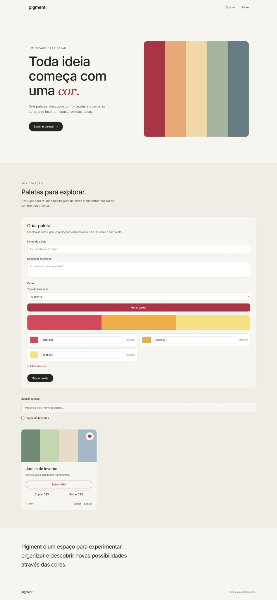

<div align="center">

# pigment.

**Toda ideia começa com uma *cor*.**

Crie paletas, descubra combinações e guarde as cores que inspiram suas próximas ideias.

</div>

<br />



<p align="center"><sub>O Pigment em funcionamento no ambiente local — captura real da página completa.</sub></p>

---

### Um espaço para criar

O Pigment é um lugar para experimentar cores sem complicar o processo criativo. Você pode partir de uma combinação aleatória, explorar harmonias ou ajustar cada tom até encontrar uma paleta que faça sentido para sua ideia.

Depois, dê um nome, escreva uma descrição e guarde a combinação na sua coleção.

### Da inspiração ao próximo projeto

**01 — Explore.** Gere paletas aleatórias ou use harmonias complementares, análogas e monocromáticas. Também é possível começar a partir de um código HEX.

**02 — Organize.** Crie, edite, pesquise e exclua paletas. Marque suas preferidas para encontrá-las com facilidade.

**03 — Use.** Copie códigos HEX e exporte suas combinações em **PNG** ou **CSS** para levar as cores a outros projetos.

### Feito para deixar as cores em primeiro plano

O design combina fundos claros, tipografia direta, bastante espaço livre e pequenos acentos de cor. A interface foi desenvolvida para funcionar em diferentes tamanhos de tela, com atenção à acessibilidade.

### Por trás das cores

| | Tecnologias |
| :-- | :-- |
| **Interface** | React, TypeScript, Vite e Tailwind CSS |
| **API** | Java, Spring Boot e Spring Data MongoDB |
| **Banco de dados** | MongoDB |
| **Ambiente de desenvolvimento** | Docker Compose, Maven e npm |

O frontend consome a API REST do backend pelas rotas `/api/paletas`.

<details>
<summary><strong>Executar localmente</strong></summary>

<br />

**Pré-requisitos:** Java 21, Node.js compatível com o Vite, Docker com Compose e Maven (ou Maven Wrapper, se disponível no projeto).

```bash
git clone https://github.com/gabrielacarla/pigment.git
cd pigment
```

**1. Banco de dados**, na raiz do projeto:

```bash
docker compose up -d
```

**2. Backend**, em outro terminal:

```bash
cd backend
mvn spring-boot:run
```

Se o projeto incluir Maven Wrapper, você também pode usar `./mvnw spring-boot:run` (Linux/macOS) ou `mvnw.cmd spring-boot:run` (Windows).

**3. Frontend**, em outro terminal, a partir da raiz:

```bash
cd frontend
npm ci
npm run dev
```

Abra `http://localhost:5173` no navegador.

Para verificar o frontend:

```bash
npm run lint
npm run build
```

</details>

<details>
<summary><strong>Rotas da API</strong></summary>

<br />

| Método | Rota | Descrição |
| :-- | :-- | :-- |
| `GET` | `/api/paletas` | Lista as paletas |
| `POST` | `/api/paletas` | Cria uma paleta |
| `PUT` | `/api/paletas/{id}` | Atualiza uma paleta |
| `PATCH` | `/api/paletas/{id}/favorita` | Alterna o estado de favorita |
| `DELETE` | `/api/paletas/{id}` | Exclui uma paleta |

</details>

---

<div align="center">

**pigment.**

<sub>Feito para explorar cores.</sub>

<sub>Desenvolvido por [Gabriela Carla](https://github.com/gabrielacarla).</sub>

</div>
