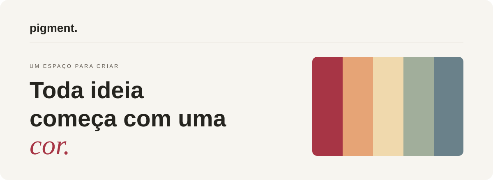

<div align="center">



<br />

Um espaço para experimentar combinações, descobrir novas possibilidades e guardar as cores que merecem ficar.

**Explore · Crie · Organize · Exporte**

[Conhecer o Pigment](https://pigment-six.vercel.app/)

</div>

---

> **Prévia online:** o link apresenta a interface do Pigment hospedada na Vercel. Como a API Spring Boot e o MongoDB não estão hospedados, as funções de carregar, salvar, editar e excluir paletas não estão disponíveis nessa demonstração. Para utilizar a aplicação completa, execute o projeto localmente seguindo as instruções abaixo.

## Um ponto de partida para novas ideias

Às vezes, uma ideia começa com uma referência. Outras vezes, com um único tom.

O **Pigment** foi criado para tornar esse processo mais simples: explorar cores, testar harmonias e transformar combinações em paletas que você pode salvar e reutilizar. Sem precisar sair da mesma interface para criar, organizar e exportar.

## O caminho das cores

### 01 / Descobrir

Comece do zero com uma paleta aleatória ou escolha uma direção: **complementar, análoga ou monocromática**. Se já tiver uma cor em mente, use seu código HEX como ponto de partida.

### 02 / Dar forma

Ajuste as cores, escolha um nome e acrescente uma descrição. Cada paleta passa a fazer parte da sua coleção, onde pode ser **pesquisada, editada, favoritada ou excluída**.

### 03 / Levar adiante

Encontrou a combinação certa? **Copie os códigos HEX** ou exporte a paleta em **PNG** e **CSS** para usar em outro projeto.

---

## Design que deixa a cor falar


O Pigment usa uma interface clara, com tipografia expressiva, espaços generosos e detalhes discretos em vermelho fechado. O objetivo é dar protagonismo às paletas, sem competir visualmente com elas.

O layout foi pensado para diferentes tamanhos de tela, com atenção à navegação e à acessibilidade.

**[Explorar a interface online](https://pigment-six.vercel.app/)**

## Construído em duas partes

| Camada | Tecnologias |
| :--- | :--- |
| **Interface** | React · TypeScript · Vite · Tailwind CSS |
| **API REST** | Java 21 · Spring Boot · Spring Data MongoDB |
| **Persistência** | MongoDB |
| **Ambiente local** | Docker Compose · Maven · npm |

A interface conversa com o backend por meio das rotas `/api/paletas`. As paletas ficam armazenadas no MongoDB, para que a coleção continue disponível entre as sessões.

<details>
<summary><strong>Como executar no seu computador</strong></summary>

<br />

Você vai precisar de **Java 21**, **Node.js compatível com o Vite**, **Docker com Compose** e **Maven** (ou o Maven Wrapper, se disponível).

Clone o repositório:

```bash
git clone https://github.com/gabrielacarla/pigment.git
cd pigment
```

**1. Inicie o MongoDB**, na raiz do projeto:

```bash
docker compose up -d
```

**2. Inicie a API**, em outro terminal:

```bash
cd backend
mvn spring-boot:run
```

**3. Inicie a interface**, em um terceiro terminal, a partir da raiz do projeto:

```bash
cd frontend
npm ci
npm run dev
```

Acesse **http://localhost:5173**.

Para verificar o frontend:

```bash
npm run lint
npm run build
```

> O projeto está configurado para desenvolvimento local. A API utiliza o MongoDB local e o Vite encaminha as chamadas `/api` para o backend em `localhost:8080`.

</details>

<details>
<summary><strong>Rotas da API</strong></summary>

<br />

| Método | Endpoint | Ação |
| :--- | :--- | :--- |
| `GET` | `/api/paletas` | Listar paletas |
| `POST` | `/api/paletas` | Criar paleta |
| `PUT` | `/api/paletas/{id}` | Editar paleta |
| `PATCH` | `/api/paletas/{id}/favorita` | Alternar favorita |
| `DELETE` | `/api/paletas/{id}` | Excluir paleta |

</details>

---

<div align="center">

**pigment.**

*As próximas ideias também começam por aqui.*

<sub>Projeto desenvolvido por <a href="https://github.com/gabrielacarla">Gabriela Carla</a>.</sub>

</div>
